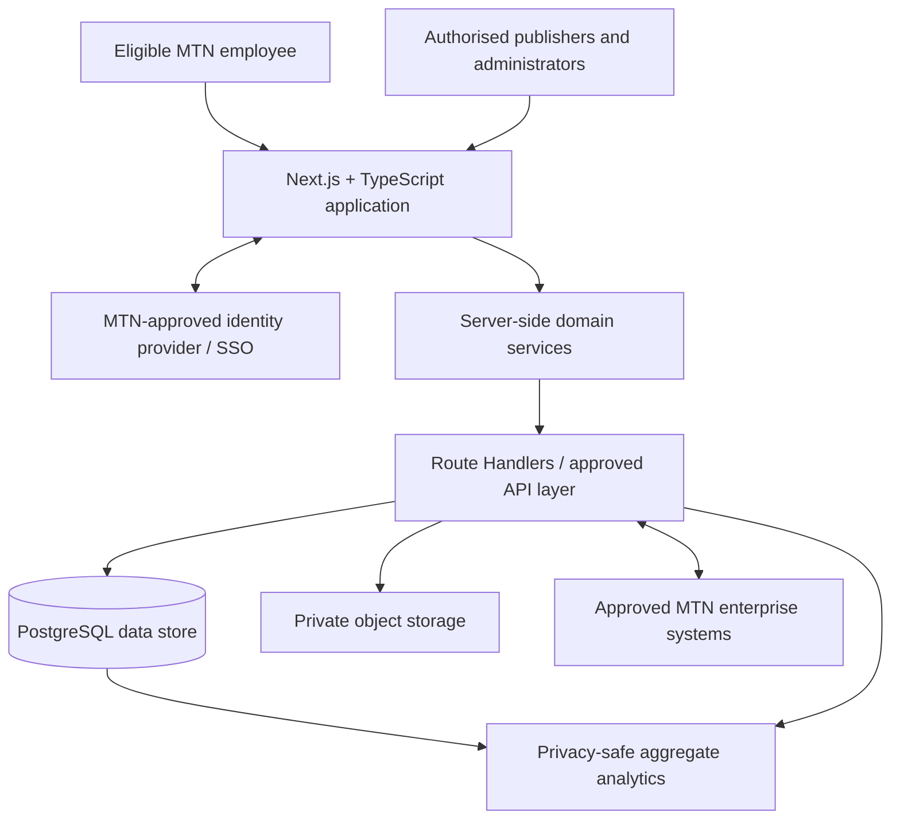

# MTN Konect — Technical Architecture

**Status:** Proposed architecture for review; not an approved MTN production design.  
**Frontend and web framework:** Next.js + TypeScript  
**Repository:** https://github.com/Jablo-cmd/Mtn-inside

## 1. Purpose

This document defines the proposed architecture for evolving the MTN Konect concept prototype into a secure, maintainable, mobile-friendly employee experience platform using Next.js and TypeScript. It explains the system boundaries, application structure, data domains, security controls, deployment approach and implementation sequence.

This is a design baseline, not proof that the described components are implemented. MTN's enterprise architecture, identity, security, privacy, legal, data and infrastructure teams must review the design before real employee or company data is used.

## 2. Architecture decisions at a glance

| Area | Proposed choice | Reason |
|---|---|---|
| Web framework | Next.js with App Router | Integrated routing, layouts, server rendering and server-side capabilities |
| Language | TypeScript with strict mode | Type safety across UI and server code |
| UI | React Server Components by default; Client Components where interaction requires them | Reduce unnecessary client JavaScript and keep server-only logic on the server |
| Styling | Tailwind CSS or MTN-approved design system | Responsive, consistent UI; final design system subject to brand approval |
| Forms and validation | React Hook Form + Zod where appropriate | Consistent forms and validation |
| Server state | Server Components for initial reads; TanStack Query only where client-side caching/revalidation is useful | Avoid unnecessary duplicated state |
| Backend/API | Next.js Route Handlers and Server Actions for suitable app-owned operations; separate service/API layer for integrations | Keep privileged logic server-side and isolate external integrations |
| Database | PostgreSQL | Relational data, constraints, transactions and mature access controls |
| Data access | Server-only repository/service layer; ORM/query library selected after review | Keep database access out of browser bundles and centralise domain rules |
| Authentication | MTN-approved identity provider and SSO | Enterprise identity, access governance and account lifecycle |
| File storage | Private object storage with short-lived signed access | Protect attachments and media |
| Validation | Zod at input boundaries plus database constraints | Client validation improves UX; server validation is authoritative |
| Testing | Vitest, React Testing Library and Playwright | Unit, component and end-to-end coverage |
| Delivery | GitHub Actions or MTN-approved CI/CD | Repeatable checks and controlled releases |
| Hosting | MTN-approved cloud/platform | Data residency, network, vendor and security requirements decide the target |

Supabase may be considered for PostgreSQL, authentication, storage and realtime features only if MTN approves it. It is not assumed to be selected or connected to production. If MTN requires an internal cloud, identity provider, API gateway or managed database, use those approved services instead.

## 3. System context



The browser is an untrusted client. It may display data and request permitted actions, but it must never be the authority for identity, role, approval status or access to restricted information. Server Components and server-only modules must not leak secrets or privileged data into rendered HTML, client props or browser bundles.

## 4. Application layers

### 4.1 Presentation layer

Use Next.js App Router with React and TypeScript.

- Use Server Components by default for pages that can render on the server.
- Add the `'use client'` directive only for components that need browser interaction, local state, effects or client-only libraries.
- Provide responsive, accessible layouts and consistent loading, empty, error and permission-denied states.
- Keep interactive components focused; avoid turning the entire application into one large Client Component.
- Use typed props and validate untrusted API responses at boundaries.
- Do not include secrets, privileged keys or sensitive employee data in client bundles.

### 4.2 Domain/service layer

Organise code by business capability rather than building a monolithic page or a collection of unstructured API calls.

Each feature should define its:
- Routes and page components.
- Reusable UI components.
- Domain types and validation schemas.
- Server-side service/repository functions.
- Permission requirements.
- Tests.

Critical business rules—such as who can publish official notices, approve campaigns, moderate reports or assign roles—must be enforced server-side and, where applicable, by database policies. Hiding a button in React is not authorisation.

### 4.3 Server and API layer

Use Server Actions for suitable mutations initiated by the application UI and Route Handlers for explicit HTTP endpoints, integrations and clients that need an API. Keep domain rules in shared server-only services rather than duplicating them across both.

Responsibilities:
- Authenticate and authorise every request.
- Validate all inputs on the server.
- Apply domain rules and transactional changes.
- Integrate with MTN identity, HR, recruitment, communications or campaign systems only when approved.
- Apply rate limits, audit sensitive actions and return predictable errors.
- Keep provider-specific code behind adapters.
- Avoid exposing stack traces, secrets or internal implementation details in errors.

Privileged operations must never rely solely on client-side checks. Do not ship database passwords, service-role keys, private API keys or other secrets to the browser.

### 4.4 Data layer

PostgreSQL is the proposed relational store. Enforce foreign keys, uniqueness, check constraints and transaction integrity wherever appropriate.

If Supabase is approved:
- Enable row-level security (RLS) on every exposed table.
- Design policies from the actual role, market and record-access model.
- Do not treat authenticated status as sufficient permission by itself.
- Do not use user-editable profile metadata to grant roles.
- Keep service-role keys and administrative operations server-side.
- Test access as unauthenticated, ordinary employee, moderator, official publisher and platform administrator.

If MTN chooses a different platform, implement equivalent or stronger controls in its approved services.

## 5. Suggested Next.js project structure

```text
src/
  app/
    (public)/
    (authenticated)/
      layout.tsx
      page.tsx
      community/
      notices/
      products/
      careers/
      recognition/
      ideas/
      events/
      groups/
      profile/
      admin/
      analytics/
    api/
      health/
      webhooks/
    layout.tsx
    globals.css
    error.tsx
    not-found.tsx
  components/
    ui/
    layout/
    feedback/
  features/
    auth/
    community/
    notices/
    products/
    careers/
    recognition/
    ideas/
    events/
    groups/
    moderation/
    analytics/
  server/
    auth/
    services/
    repositories/
    integrations/
    security/
  lib/
    validation/
    config/
    logging/
  types/
  test/
```

This is a target structure, not a description of the current single-file prototype. Add modules as they are implemented. Keep server-only modules clearly separated and mark them with Next.js's server-only guard where appropriate. Do not import server modules into Client Components.

## 6. Core product modules

### 6.1 Identity and access
- Authenticate employees through an MTN-approved identity provider.
- Map trusted identity claims to a server-managed Konect profile.
- Assign roles and market membership through controlled administrative processes.
- Support suspension, departure and access revocation.
- Use a non-sensitive internal profile ID in application relationships.
- Never expose Oracle numbers or employee identifiers as public profile IDs.

### 6.2 Community
- Posts, comments, reactions, topics and optional attachments.
- Pagination and feed filtering.
- Reporting, moderation decisions and appeals.
- Server-enforced ownership and edit/delete permissions.
- Approved retention and deletion rules.

### 6.3 Official notices
- Draft, review, publish, update and expire lifecycle.
- Publisher role and optional approval workflow.
- Audience rules such as market, business unit or approved group.
- Audit record for who published or changed each official notice.
- Clear distinction from employee-generated content.

### 6.4 Product campaigns
- Campaign owner, approved creative, market, audience, eligibility, terms, start/end dates and destination link.
- Approval status and publication workflow.
- Click and conversion measurement only where permitted and properly disclosed.
- No campaign may be published solely because an ordinary employee has an account.

### 6.5 Careers and learning
- Approved opportunities and learning links.
- Market and eligibility information.
- Integration with official recruitment or learning systems where authorised.
- Konect does not independently make hiring or promotion decisions.

### 6.6 Recognition
- Peer appreciation and approved recognition categories.
- Visibility and moderation settings.
- Separation between informal appreciation and formal performance or reward processes.

### 6.7 Ideas and innovation
- Challenges, submissions, reviewer assignment, status, decisions and outcome tracking.
- Controlled access for sensitive challenges.
- Clear intellectual-property and confidentiality terms before accepting submissions.

### 6.8 Events and groups
- Local and global event listings, time zones, registrations and updates.
- Group ownership, membership, privacy and moderation.
- Country relevance and access controls.

### 6.9 Analytics
- Aggregate engagement, communications, campaign and innovation metrics.
- Metric definitions, event provenance and data-quality checks.
- Role-based analytics access.
- No covert individual-level monitoring or use of engagement as an employee-performance score.

### 6.10 Future AI assistant
- Use only approved source systems and content.
- Respect the requesting employee's permissions at retrieval time.
- Provide source links, handle uncertainty and allow escalation.
- Evaluate quality without unnecessarily retaining sensitive prompts.
- Keep AI out of consequential employment decisions unless a separate approved governance process explicitly permits a narrowly defined use.

## 7. Initial logical data model

This is a conceptual model, not a final database schema or migration.

| Entity | Purpose | Important relationships |
|---|---|---|
| `profiles` | Internal user profile and preferences | Links to trusted identity subject; belongs to approved market(s) |
| `markets` | Country or operating-market directory | Used for audience and offer rules |
| `memberships` | User membership in markets and groups | Profile + market/group + status |
| `roles` / `role_assignments` | Trusted permissions | Controlled administrative assignment |
| `posts` | Community content | Author, optional group, status |
| `comments` | Replies to posts | Comment author and parent post |
| `reactions` | User reactions | Unique user/reaction combination per target |
| `content_reports` | Safety reports | Reporter, target content, status and resolution |
| `moderation_actions` | Moderator decisions | Moderator, report/content and action |
| `official_notices` | Approved internal announcements | Publisher, audience, approval and lifecycle dates |
| `campaigns` | Approved product campaigns | Owner, market, eligibility, terms and dates |
| `campaign_events` | Permitted campaign interactions | Campaign and event type; minimise personal data |
| `career_opportunities` | Approved vacancy metadata or links | Source system, market, eligibility and expiry |
| `recognitions` | Employee appreciation | Sender, recipient, category and visibility |
| `innovation_challenges` | Business problem or challenge | Owner, review process and dates |
| `idea_submissions` | Employee proposals | Challenge, author, status and review outcome |
| `events` / `event_registrations` | Event listings and attendance intent | Event, eligible user and registration status |
| `groups` / `group_memberships` | Community spaces | Owner, members, access and moderation settings |
| `audit_events` | Sensitive administrative actions | Actor, action, target and timestamp |

Use UUIDs or another non-sensitive internal key for application IDs. Do not use Oracle numbers or employee identifiers as public IDs. Store only the personal data needed for a defined purpose, with approved retention periods.

## 8. Authentication and authorisation

Authentication answers **who signed in**. Authorisation answers **what that person may do**. These are separate checks.

Proposed roles:
- **Employee:** read permitted content and use normal community features.
- **Group moderator:** moderate assigned groups within defined boundaries.
- **Community moderator:** handle reports and content in authorised areas.
- **Official publisher:** create and publish approved notices or campaigns within assigned scope.
- **Approver:** approve defined classes of official content.
- **Platform administrator:** manage configuration and roles; this access should be limited and audited.
- **Analytics viewer:** access approved aggregate metrics only.

Roles should be scoped to markets or content areas where possible. Sensitive actions must be authorised server-side and create audit records. Avoid one all-powerful administrator role for routine work.

## 9. Main request flows

### Employee reads the community feed
1. Employee signs in using the approved identity provider.
2. The application establishes a valid session.
3. The page or server-side service requests the feed.
4. The server checks identity, eligibility, market/group permissions and content status.
5. Only permitted posts are returned.
6. The page renders the response and handles empty, loading and error states.

### Employee submits a post
1. The UI validates fields for usability.
2. The server validates the request again.
3. The server verifies the account is active and permitted to post.
4. The database stores the post under the authenticated user.
5. Moderation, reporting and rate-limit controls apply.
6. The UI refreshes the relevant data after success.

### Authorised team publishes a product campaign
1. A permitted publisher creates a draft.
2. Required fields and assets are validated.
3. The configured approver reviews it when approval is required.
4. The server checks publisher scope, approval status, market, eligibility and dates.
5. The campaign becomes visible only to its approved audience and during its active period.
6. Permitted analytics events are recorded with privacy safeguards.
7. Changes, approvals and publication actions are auditable.

## 10. Security and privacy baseline

Production must not launch until these controls are designed, implemented and tested:

- MTN-approved identity integration and account lifecycle.
- Least-privilege role and market access.
- Server-side authorisation for every sensitive operation.
- RLS or equivalent database-level access control.
- Secure session handling and revocation.
- Input validation, output encoding and protection against common web attacks.
- Rate limits and abuse prevention for posts, comments, reactions and reports.
- Private file storage, file type/size restrictions, malware scanning where appropriate and short-lived access links.
- Secrets management and separate development, test and production environments.
- Dependency scanning, lockfiles, code review and security testing.
- Audit logs for role changes, official publication, moderation and sensitive administration.
- Data minimisation, purpose limitation, retention/deletion controls and privacy notices.
- Backup/restore tests, monitoring, incident response and operational ownership.
- Accessibility testing and safe error messages.

Do not place confidential MTN information or real employee data in the public prototype. Do not connect production data or enterprise identity without explicit authorisation.

## 11. Non-functional requirements

The pilot must set explicit acceptance thresholds for:
- **Availability:** agreed service level and maintenance windows.
- **Performance:** page-load and API response targets on supported devices and networks.
- **Scalability:** load testing for pilot users and an agreed growth scenario.
- **Accessibility:** WCAG target selected with MTN.
- **Compatibility:** agreed browser, mobile and device support.
- **Resilience:** backup/restore tests and recovery objectives.
- **Observability:** application errors, latency, availability, failed authentication and security events.
- **Maintainability:** typed interfaces, code review, automated tests, documentation and ownership.
- **Localisation:** country, language, time zone, currency and market-specific campaign handling where required.

Set numerical targets with the sponsor and technical owners after usage and infrastructure are understood.

## 12. Environments and deployment

Maintain separate environments:
- **Local development:** synthetic data only.
- **Automated test/preview:** synthetic or explicitly approved test data.
- **Staging/UAT:** controlled test accounts and approved test data.
- **Production:** approved identity, real data, monitoring, backups and change control.

Recommended pipeline:
1. Open a pull request with a clear change description.
2. Run TypeScript type checking, linting, unit/component tests and dependency/security checks.
3. Build the app and run relevant integration/end-to-end tests.
4. Require review and passing checks before merge.
5. Deploy to preview/staging.
6. Complete user acceptance and security approvals.
7. Promote using an approved release process.
8. Monitor and maintain a rollback plan.

GitHub Pages can host a static concept demo, but it is not a secure production hosting solution for confidential employee data. Production hosting must be selected with MTN.

## 13. Testing strategy

- **Unit tests:** domain rules, validation, formatting and permission helpers.
- **Component tests:** accessible controls, forms, loading/error states and interactions.
- **API/integration tests:** validation, permissions, data access and failure cases.
- **Security tests:** unauthorised access, cross-market access, privilege escalation, IDOR/BOLA, injection, XSS, upload abuse and session revocation.
- **End-to-end tests:** sign-in, read feed, submit/report content, publish an approved notice and view a market-specific campaign.
- **Accessibility tests:** keyboard navigation, focus, semantics, contrast and screen-reader flows.
- **Performance tests:** representative feed sizes, concurrent access and media delivery.
- **Recovery tests:** backup restoration and release rollback.

Include negative cases: users must not be able to perform an action by directly calling an endpoint or changing a client-side role value.

## 14. Implementation sequence

### Phase 0 — Architecture and discovery
Validate needs, map existing MTN platforms, select hosting/identity/data/integration standards with MTN, and define the threat model, roles and pilot metrics.

**Exit criterion:** approved architecture decisions and bounded pilot scope.

### Phase 1 — Secure application foundation
Establish the Next.js + TypeScript structure, routing, design system, error handling, configuration and tests. Implement approved authentication, profile lifecycle, backend, migrations, access policies and audit logging.

**Exit criterion:** secure sign-in, least-privilege access and automated test pipeline demonstrated.

### Phase 2 — Pilot community and communications
Implement feed, posts, comments, reporting, moderation and official notices with authorised publishing and lifecycle controls. Add mobile/accessibility improvements and basic aggregate metrics.

**Exit criterion:** agreed user journeys pass functional, security and acceptance tests.

### Phase 3 — One measurable business use case
Select one use case with the sponsor, such as a product campaign, innovation challenge or career discovery. Implement only the workflow and analytics needed to evaluate it.

**Exit criterion:** results can be compared against an agreed baseline.

### Phase 4 — Evaluate and extend
Assess adoption, outcomes, cost, risk and feedback. Fix gaps before adding modules. Consider recognition, events, further integrations and AI only when approved and justified.

**Exit criterion:** documented stop, revise, continue or expand decision.

## 15. Decisions still requiring MTN input

1. Hosting/cloud provider and network boundaries.
2. Identity provider, SSO protocol and contractor eligibility.
3. Whether Supabase is permitted or MTN-managed APIs/database are required.
4. Authoritative sources for employee profiles, market membership, vacancies, learning and campaigns.
5. Data residency, retention and cross-border transfer requirements.
6. Content moderation ownership and operating hours.
7. Approval workflows for official notices and product promotions.
8. Analytics scope, notice/consent requirements and attribution model.
9. Accessibility, availability, performance and recovery targets.
10. IP ownership, source-code licensing, support model and vendor exit requirements.

## 16. Architecture acceptance checklist

- [ ] Problem and pilot use case are validated.
- [ ] Existing MTN platforms and integrations are mapped.
- [ ] Next.js + TypeScript structure and coding standards are agreed.
- [ ] Identity, account lifecycle and role model are approved.
- [ ] Every exposed data resource has explicit access controls.
- [ ] Server-side validation and authorisation are in place.
- [ ] Privacy, retention and deletion are documented.
- [ ] Official content and campaign approval workflows are defined.
- [ ] Security, accessibility, performance and recovery tests pass.
- [ ] Monitoring, support, incident response and ownership are assigned.
- [ ] Baseline metrics, costs and pilot success criteria are agreed.
- [ ] MTN has approved branding, deployment and use of company data.

## 17. Final architecture principle

**Next.js + TypeScript provides the web application and server-side application layer; the authorised backend enforces business rules; the database protects data access; MTN-approved identity establishes who the user is; and measurable analytics establish whether the product delivers value.**

No production deployment should occur until MTN approves the design, platform choices, identity integration, data handling, security controls and operating model.
